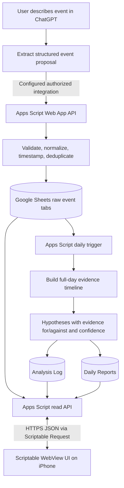

# Gut Genie — Product & Technical Specification

**Status:** Proposed design for review; no runtime code or deployments yet  
**Platform:** iPhone Scriptable (WebView UI) + Google Apps Script Web App + Google Sheets  
**Timezone:** Asia/Kolkata (IST)  
**Planned spreadsheet:** [Gut Genie tracking spreadsheet](https://docs.google.com/spreadsheets/d/1rIQWc2thSUKHDiFOUtH9fSSkgI5hqisTrblaLVtW8jQ/edit)  
**Reference implementation:** [Recipe Tracker](https://github.com/paaras03/recipe-tracker)

## 1. Product summary

Gut Genie is a personal logging and analysis tool. The user should be able to describe ordinary events in a ChatGPT conversation—meals, ingredients and portions, symptoms, sleep, exercise, bowel movements, and context—without filling in a complex form every time. Those facts become structured, timestamped Google Sheets rows. A separate analysis layer assesses each day as a whole, preserves competing explanations, and suggests one practical next experiment. A Scriptable app on iPhone shows live data and historical reports.

The app is **not a web app**. Scriptable hosts the front end using a WebView. Google Apps Script is the API/backend, and Google Sheets is the data store.

### Principles

1. Low-friction, natural-language capture; ask follow-up questions only when missing information materially changes a record.
2. Separate raw facts from interpretation. Hypotheses and recommendations live in separate tabs.
3. Preserve event time and symptom onset. Do not assume the most recent meal caused a symptom.
4. Analyze the whole day, including portions, cumulative exposures, sleep, exercise, bowel movements, and timing.
5. Record supporting evidence, counter-evidence, confounders, data gaps, and qualitative confidence.
6. Keep the spreadsheet inspectable and correctable.
7. Never commit credentials, tokens, or personal digestive data to GitHub.

## 2. Architecture



| Component | Responsibility | Source of truth? |
|---|---|---|
| ChatGPT | Natural-language input and summaries | No |
| ChatGPT-to-API integration | Sends structured event payloads | No |
| Apps Script Web App | API, validation, timestamps, sheet reads/writes and report orchestration | No |
| Google Sheets | Raw events, hypotheses, daily reports, settings and optional audit history | **Yes** |
| Scriptable JavaScript | iPhone entry point, WebView interface and API client | No |
| Apps Script time trigger | Runs analysis even when Scriptable is closed | No |
| GitHub | Versioned source, specifications, tests and checkpoints | No user event data |

### Connectivity constraint

ChatGPT does not automatically gain write access to Sheets just because a repository or endpoint exists. Automatic logging requires a configured integration capable of making authorized HTTP requests to Apps Script, or an explicit manual fallback. That integration is a distinct workstream and is not considered configured by this spec.

Scriptable's dashboard connection is separate: it calls the Apps Script HTTPS endpoint with Scriptable `Request` and parses JSON. It does not access Sheets directly and does not embed Google credentials in the client.

## 3. End-to-end flows

### Natural-language logging

1. User says something like: “Lunch at 1:15: rice, tofu and cucumber. Gas started around 5:30, moderate amount, mild smell.”
2. ChatGPT extracts one or more event objects without inventing missing fields.
3. If a material field is ambiguous, ask one concise question; otherwise leave unknowns blank.
4. Integration sends JSON with event type, event time if known, event data, and an idempotency key.
5. Apps Script validates, assigns a server-side `captured_at`, appends to the correct tab, and returns the record ID.
6. The assistant confirms only after a successful write; failures must not be silently reported as success.

### Live dashboard

1. Scriptable runs `scriptable/Gut Genie.js`.
2. It requests `?action=dashboard`.
3. Apps Script returns today's timeline, symptom summary, data completeness, report status, and recent hypotheses.
4. WebView renders it in Recipe Tracker's warm neutral visual style.
5. A selected report uses `?action=report&id=...`; history uses `?action=reports&limit=...`; refresh reloads from Sheets.
6. On API failure, show an explicit error and last successful refresh time. Cached data is never treated as authoritative.

### Daily report generation

1. Apps Script time trigger runs at a configurable local time (proposed default: 11:00 PM IST).
2. It loads events for the target local date plus a configurable preceding context window for delayed symptoms/overnight effects.
3. It orders events by event time and computes meal-to-symptom intervals while preserving overlapping candidate exposures.
4. It writes hypotheses with support, counter-evidence, confounders, data gaps and confidence.
5. It stores a full-day report in `Daily Reports` and hypothesis rows in `Analysis Log`.
6. Re-runs use a stable report key/version policy; they must not create duplicate indistinguishable reports.
7. Sparse days return `insufficient_data`, not fabricated conclusions.

**The daily trigger belongs in Apps Script, not Scriptable.** iOS does not guarantee Scriptable will open at a scheduled time.

## 4. Google Sheets structure

**Use the spreadsheet provided by the user:** [Gut Genie tracking spreadsheet](https://docs.google.com/spreadsheets/d/1rIQWc2thSUKHDiFOUtH9fSSkgI5hqisTrblaLVtW8jQ/edit). The link is recorded here as the planned data location; this spec does not imply that the spreadsheet has been inspected, modified, or connected to Apps Script. Before implementation, inspect its current tabs and headers, preserve any existing user data, and add/rename tabs deliberately rather than assuming it is empty.

Use one spreadsheet with these tabs. Resolve columns by header names, not fixed positions, following Recipe Tracker. IDs must be stable; row numbers are not IDs.

### `Food Log` — one row per meal/drink event

| Column | Meaning |
|---|---|
| `record_id` | Stable unique ID |
| `occurred_at` | Event time, ISO 8601 with offset or normalized UTC |
| `local_date` | `YYYY-MM-DD` in Asia/Kolkata |
| `captured_at` | Server timestamp of write |
| `meal_type` | Breakfast / Lunch / Dinner / Snack / Drink / Unknown |
| `description` | Concise user-provided meal description |
| `items_json` | Known items, quantities, units, preparation and notes |
| `fodmap_groups` | Known/possible groups only when grounded; no inferred exact dose |
| `estimated_load` | Optional coarse estimate or unknown, never clinical measurement |
| `source_message_id` | Optional source/idempotency reference |
| `notes` | Extra context provided by user |
| `data_quality` | complete / partial / uncertain |

Initially, `items_json` can store meal items. Add a separate `Food Items` tab only if later querying requires normalization.

### `Symptom Log` — one row per symptom observation group

| Column | Meaning |
|---|---|
| `record_id` | Stable ID |
| `occurred_at` | Symptom onset or observation time |
| `captured_at` | Server write timestamp |
| `symptoms` | Fullness, gas, acidity, bowel urgency, pain, etc. |
| `fullness_score` | Optional 0–10 |
| `gas_level` | Low / Medium / High / Unknown; combined frequency/volume estimate |
| `gas_smell` | None / Mild / Strong / Unknown |
| `acidity_score` | Optional 0–10 |
| `pain_score` | Optional 0–10, only if discussed |
| `bowel_urgency` | None / Mild / Moderate / Severe / Unknown |
| `onset_type` | Started now / ongoing / noticed after waking / unknown |
| `description` | Original wording, preserving nuance |
| `data_quality` | complete / partial / uncertain |

Do not force numerical scores when the user describes symptoms qualitatively. Empty/unknown is not zero.

### `Sleep Log`

| Column | Meaning |
|---|---|
| `record_id` | Stable ID |
| `sleep_start` | Sleep start if known |
| `wake_at` | Wake time |
| `duration_minutes` | Derived only when times are reliable |
| `quality_score` | Optional; decide scale before implementation |
| `captured_at` | Server timestamp |
| `notes` | User-reported context |

### `Exercise Log`

| Column | Meaning |
|---|---|
| `record_id` | Stable ID |
| `started_at` | Start time |
| `ended_at` | End time if known |
| `activity_type` | Walk / strength / cardio / other / unknown |
| `duration_minutes` | Derived if available |
| `intensity` | Easy / Moderate / Hard / Unknown |
| `notes` | User-provided context |
| `captured_at` | Server timestamp |

### `Bowel Log`

Only create a row when bowel details are shared; do not force a daily questionnaire.

| Column | Meaning |
|---|---|
| `record_id` | Stable ID |
| `occurred_at` | Time |
| `stool_form` | Bristol 1–7, optional |
| `urgency` | None / Mild / Moderate / Severe / Unknown |
| `straining` | Yes / No / Unknown |
| `incomplete_emptying` | Yes / No / Unknown |
| `description` | Original report |
| `captured_at` | Server timestamp |

### `Analysis Log` — one row per hypothesis per report run

| Column | Meaning |
|---|---|
| `analysis_id` | Stable hypothesis-record ID |
| `report_id` | Parent report |
| `created_at` | Timestamp |
| `target_date` | Local day being assessed |
| `hypothesis` | Possible association in plain language |
| `factor_type` | food / ingredient / FODMAP group / portion / timing / sleep / exercise / bowel / other |
| `candidate_exposure` | Food, pattern or contextual factor |
| `supporting_evidence` | Specific source record IDs, times and observations |
| `evidence_against` | Contradictory observations or failed replications |
| `confounders` | Other plausible causes/overlapping exposures |
| `observations_count` | Relevant observations, not necessarily independent trials |
| `confidence` | Very low / Low / Moderate / High |
| `confidence_rationale` | Reason for label |
| `next_test` | One practical experiment |
| `status` | hypothesis / testing / supported / weakened / inconclusive / retired |
| `supersedes_analysis_id` | Optional link to an earlier version |

Confidence describes personal evidence strength, not medical certainty.

### `Daily Reports` — whole-day synthesis per date/version

| Column | Meaning |
|---|---|
| `report_id` | Stable key e.g. `daily-YYYY-MM-DD` with version if needed |
| `local_date` | Report date in Asia/Kolkata |
| `generated_at` | Server timestamp |
| `version` | Revision number |
| `status` | complete / partial / insufficient_data / failed |
| `day_summary` | Concise narrative |
| `symptom_summary` | Symptoms and severity pattern |
| `food_and_timing_summary` | Intake, quantities, timing, possible cumulative exposure |
| `sleep_summary` | Sleep context if logged |
| `exercise_summary` | Exercise context if logged |
| `bowel_summary` | Bowel context if logged |
| `strongest_associations` | Summaries tied to analysis IDs |
| `evidence_against` | Major conflicting observations |
| `missing_data` | Important unknowns/gaps |
| `next_experiment` | One recommended next step |
| `experiment_rationale` | Why this test is informative |
| `safety_note` | Appropriate escalation guidance if needed |

### `Settings` — configuration, no secrets

Use key/value rows: `timezone` (`Asia/Kolkata`), `daily_report_time` (proposed `23:00`), `analysis_context_hours` (proposed 24–48), `symptom_scales`, `schema_version`, `last_successful_analysis_at`, `retention_policy`, and optional `web_app_url` (endpoint only, no credential).

Optional later tab: `Food Dictionary` for aliases, likely FODMAP groups, portion notes and reference links. It is enrichment metadata, not proof of what a specific meal contained.

## 5. IDs, timestamps and integrity

- Keep `occurred_at` separate from server-created `captured_at`.
- Preserve `local_date` in `Asia/Kolkata`.
- If a time lacks a date, infer today only when context makes it unambiguous; otherwise ask or mark approximate.
- If a symptom is reported later, preserve stated onset and current capture time separately.
- Never guess quantity, ingredients, FODMAP content, score or onset.
- Use Apps Script `LockService` around deduplication-sensitive writes.
- Retry-safe writes use an idempotency key/source message ID.
- Keep raw events auditable; define correction and report-staleness behavior before implementation.
- Sanitize UI output without changing stored source text.
- Use synthetic test data only in GitHub.

## 6. API contract

Follow Recipe Tracker's action-based JSON API pattern, with one security improvement: all sensitive reads and writes use POST JSON so the shared API token is not placed in the URL. The public GET endpoint returns only a generic service/version message.

| Action | Method | Purpose |
|---|---|---|
| `version` | GET or POST | Public build version via GET; authenticated version details via POST |
| `health` | POST | Sheet access, schema and trigger status, no secrets |
| `inspect-schema` | POST | Read existing tab names, row counts and headers without changing data |
| `setup-schema` | POST | Explicitly create missing tabs / initialize empty tabs only |
| `dashboard` | POST | Today's overview and latest report state |
| `events` | POST | Read events by date range/type with pagination |
| `report` | POST | Fetch one report by ID/date |
| `reports` | POST | Historical reports |
| `hypotheses` | POST | Analysis records, optionally filtered by status |
| `log-event` | POST | Validate and append event |
| `update-event` | POST | Correct permitted fields |
| `analyse-day` | POST | Reserved; analysis engine not implemented yet |
| `run-status` | POST | Latest scheduled/manual run status |
| `export` | POST | Optional later export |

### Request example

```json
{
  "action": "log-event",
  "idempotency_key": "unique-source-event-key",
  "event_type": "symptom",
  "occurred_at": "2026-10-18T17:30:00+05:30",
  "data": {
    "symptoms": ["gas"],
    "gas_level": "Medium",
    "gas_smell": "Mild",
    "description": "Gas started around 5:30 PM"
  }
}
```

Server-generated `captured_at` overrides any client value. Example response:

```json
{
  "success": true,
  "record_id": "evt_example",
  "event_type": "symptom",
  "stored_at": "2026-10-18T12:05:00Z",
  "schema_version": 1
}
```

Every response includes `success`; errors include safe `error` text and optional `code`. Never return credentials, Script Properties, stack traces or secret-bearing provider responses.

### Security is a release blocker

Digestive data is sensitive. A public Apps Script endpoint is not private merely because its URL is obscure. Before enabling writes, choose restricted access: authenticated Google identity, a token kept only in Script Properties and passed securely by the chosen integration, or another controlled mechanism. Do not put shared write secrets in public GitHub code. Test whether the selected client/integration can pass credentials safely.

## 7. Connecting ChatGPT

The requested behavior—“tell ChatGPT naturally and have structured data written automatically”—is not achieved by Scriptable alone.

1. Preferred if available: configured ChatGPT Action/connector calling the authenticated API with success/error results.
2. Alternative: configured action calls a small authenticated relay service that forwards to Apps Script, adding hosting/security complexity.
3. Early manual fallback: ChatGPT produces validated structured event data for a Scriptable logging utility or Apps Script form.

Do not build a custom ChatGPT frontend first. Validate the sheet/API schema and secure write path, then connect the conversation. Verify current plan and integration capabilities before selecting option 1; this spec does not claim it is already configured.

## 8. Daily analysis methodology

1. Select the local day and relevant preceding context for delayed symptoms.
2. Order food, symptoms, sleep, exercise and bowel events by event time.
3. Calculate candidate exposure windows; preserve overlapping meals rather than assigning symptoms only to the latest meal.
4. Consider ingredients, portions, known/possible FODMAP groups, cumulative exposure, lunch/dinner timing, preparation, sleep/waking, exercise, bowel movements and missing data.
5. Compare with prior days, including similar symptom-free exposures and counter-evidence.
6. Save explicit hypotheses with support, counter-evidence, confounders and data gaps.
7. Suggest one controlled practical experiment that changes one variable while holding others as stable as possible.
8. Explain what observation would strengthen/weaken it.
9. Use `insufficient_data` where records are sparse.

Qualitative confidence:
- **Very low:** one observation, unclear timing, major confounders or incomplete details.
- **Low:** plausible timing association but limited repetition or contradictory context.
- **Moderate:** repeated association across comparable exposures, with counter-evidence considered.
- **High:** consistent personal pattern with meaningful comparisons and few competing explanations; still not proof of causation.

Avoid numeric confidence percentages unless a transparent validated scoring method exists. Confidence is not a probability.

Illustrative example (not user data): symptoms rise 3–5 hours after a meal on two occasions; meal composition/total fermentable load is a low-confidence hypothesis; contrary evidence and different sleep/exercise context are documented; next test changes one ingredient/portion and compares similar days. Never store this example as a real conclusion.

### Medical boundary

This is an observation tool, not diagnosis. Do not diagnose IBS, SIBO, intolerance or other conditions; do not claim association proves causation; do not encourage broad long-term restrictions from one bad day. For severe, persistent or concerning symptoms—including blood in stool, unintended weight loss, fever, persistent vomiting or severe abdominal pain—recommend appropriate medical assessment rather than further dietary experimentation.

## 9. Scriptable app specification

### Runtime

- Main file: `scriptable/Gut Genie.js`.
- A Scriptable WebView hosts the interface.
- Scriptable native JavaScript uses `Request` for HTTPS JSON API calls.
- WebView/native communication may use a custom URL scheme with `shouldAllowRequest` (Recipe Tracker's pattern) or documented `evaluateJavaScript` callbacks; select one and validate parameters.
- Keep endpoint config in one clearly marked constant during prototype. Never put service-account keys or provider tokens in the client.
- Version API contracts. Handle empty sheets, missing reports, malformed responses, failures and in-progress reports.

### Navigation

Three persistent destinations, matching Recipe Tracker's visual model:

1. **Today** — symptom summary, timeline, recent logs and report status.
2. **History** — previous reports, date selection and 7/14/30-day trends.
3. **Patterns** — active hypotheses, confidence, evidence for/against and next test.

Primary add/log actions are reachable on Today. No mandatory full-day questionnaire.

### Screens

`TodayDashboard`, `EventTimeline`, `LogDetail`, `History`, `DailyReport`, `Patterns`, `PatternDetail`, `SettingsAndConnection`, `ConnectionDiagnostics`.

### Today dashboard

Show date, last refresh, event timeline, symptoms actually logged, data completeness and latest report state, with a direct link to the report. Provide manual shortcuts for food, symptom, sleep, exercise and bowel logging if the fallback is implemented. Distinguish “none reported” from “score zero”.

### Daily report

Show whole-day summary, intake/symptom timeline, potential associations, supporting evidence, evidence against/confounders, data gaps, confidence rationale, one next experiment, report version/time and previous/next-day navigation.

### Patterns

Group hypotheses by status. Cards show candidate factor, confidence, last seen, relevant occasion count and next test. Detail shows evidence and counter-evidence. Visual emphasis must not imply unjustified certainty.

### Visual direction — follow Recipe Tracker

Use its visual system rather than inventing a new one:
- warm off-white background like `#faf9f6`;
- near-black text like `#171717`;
- muted neutral labels like `#777`;
- white cards, subtle warm-gray borders like `#e5e1d9`, 14–16px corners;
- soft sand/gray secondary surfaces like `#eeeae3` and `#f2efe9`;
- near-black primary buttons with white text;
- system font stack, regular-weight screen titles and readable metadata;
- spacious cards, persistent bottom nav and soft-gray active state;
- fixed bottom action only where needed;
- lightweight inline HTML/CSS/SVG charts, no unnecessary external dependencies;
- iPhone viewport and safe-area spacing; states must not rely on color alone.

Avoid clinical dashboard styling that suggests scientific precision. Optional cache stores only the last successful response, marks it stale with timestamp, and never disguises write failure.

## 10. Proposed repository structure

```text
gut-genie/
├── README.md
├── docs/
│   ├── PRODUCT-SPEC.md
│   ├── ARCHITECTURE.md
│   ├── DATA-DICTIONARY.md
│   ├── API-CONTRACT.md
│   ├── ANALYSIS-METHODOLOGY.md
│   ├── UI-FRAMEWORK.md
│   ├── DECISIONS.md
│   └── CHECKPOINT.md
├── scriptable/
│   ├── Gut Genie.js
│   └── Log Event.js
├── google-apps-script/
│   ├── Code.gs
│   ├── Events.gs
│   ├── Sheets.gs
│   ├── Analysis.gs
│   ├── Reports.gs
│   └── appsscript.json
└── tests/
    ├── API-TEST-CASES.md
    └── sample-events.json
```

For the prototype, Apps Script can begin as one `Code.gs` file; split modules when complexity warrants. Apps Script `.gs` files share a global scope, so avoid collisions. GitHub edits do not automatically update a deployed Apps Script project. After backend changes deploy a new Web App version and verify `action=version`, matching Recipe Tracker's documented workflow.

## 11. Build phases and acceptance criteria

### Phase 0 — Spec and contracts
Confirm schema, API payloads, security, analysis model and Scriptable screen model. No credentials or personal data in GitHub.

### Phase 1 — Sheets/backend foundation
Inspect the supplied spreadsheet, back it up or preserve existing data, agree tab names/headers, and implement `health`, `version`, `dashboard`, `events` and `log-event`. Test event types, timestamps, invalid payloads, retry deduplication, header reordering, empty sheets and failures.
**Acceptance:** one scripted write produces exactly one row with stable ID, event time and capture time; API returns the same ID.

### Phase 2 — Scriptable dashboard shell
Build navigation and Today/History/Patterns with synthetic data first, then connect read APIs.
**Acceptance:** refresh reflects Sheets, historical reports open by date, and empty/error states are readable.

### Phase 3 — Natural-language integration
Select and secure ChatGPT-to-API integration. Implement extraction, ambiguity handling, retries and visible confirmations.
**Acceptance:** food, symptom, sleep and exercise messages each create correct rows; ambiguous time is not silently invented.

### Phase 4 — Daily analysis
Implement full-day context, candidate timing windows, hypotheses, counter-evidence, report persistence, time trigger, run log and manual re-analysis.
**Acceptance:** report cites source event IDs, lists conflicting evidence, handles sparse days honestly and does not duplicate on retry.

### Phase 5 — Trends and iteration
Add 7/14/30-day trends, hypothesis status transitions, data-quality indicators and export. Add deterministic report tests with synthetic events. Introduce a food dictionary only if needed.

## 12. Test cases

- Multiple meals before one symptom; symptom several hours after a meal.
- Lunch/dinner patterns without assuming one is inherently safer.
- Same food on symptom and symptom-free days.
- Missing quantity, approximate time or unclear date.
- Multi-ingredient meals and leftovers.
- Symptoms after waking before any new meal.
- Sleep/exercise overlap with candidate symptom windows.
- Bowel movement timing and symptom changes.
- Identical API retries create one event.
- Empty spreadsheet/no report/latest report failure.
- Event edited after a report exists; stale/version policy behaves predictably.
- Reordered columns, new columns or missing tabs.
- Local-date boundaries and configured timezone.
- Malformed JSON, non-200 responses, throttling and lost connection.
- Endpoint access control and secret leakage.
- Synthetic-only test data.

## 13. Decisions before implementation

These remain open decisions; the spec does not imply they are resolved.

1. **Spreadsheet:** the user supplied the spreadsheet linked above. The first API operation must be inspect-schema; preserve existing data and only run setup-schema after reviewing the returned tab names/headers. The current Apps Script code includes these actions, but they have not been run against the live spreadsheet.
2. **ChatGPT integration:** determine which secure write path is available in the user's current ChatGPT setup.
3. **Security:** choose authenticated writes before deploying an endpoint that can store sensitive notes.
4. **Analysis engine:** keep data selection and evidence storage deterministic; use an LLM for narrative only if an accessible, privacy-appropriate API is deliberately configured.
5. **Daily time:** proposed 11:00 PM IST.
6. **Corrections:** recommended behavior is to mark reports stale after edits and create a new version on re-analysis.
7. **Sleep quality:** start with hours plus optional notes; add a score only if useful.

## 14. First-version non-goals

- A public or multi-user web application.
- Medical diagnosis or prescription.
- Automatic restriction of entire FODMAP groups after one bad day.
- Exact FODMAP gram estimates without a reliable food/portion dataset.
- Background analysis tied to Scriptable being open.
- A second database alongside Sheets.
- Complex analytics before event capture and timestamps are reliable.

## 15. Recipe Tracker reference

Use [Recipe Tracker](https://github.com/paaras03/recipe-tracker) as the primary reference:

- `scriptable/Recipe Tracker.js`: Scriptable WebView, visual system, bottom navigation, Request calls, JSON API calls and bridge pattern.
- `google-apps-script/Code.gs`: action router, `doPost`, header-based schema lookup, JSON responses, Script Properties and duplicate protections.
- `docs/APP-ARCHITECTURE-FRAMEWORK.md`: screen/navigation documentation style.
- `docs/BACKEND-INFRASTRUCTURE.md`: backend/API/deployment documentation style.
- `docs/PRODUCT-SPEC.md`: product behavior specification.

Reuse the architecture and visual patterns, but keep Gut Genie's data model, UI, IDs and analysis semantics independent. Do not copy Recipe Tracker's spreadsheet ID, endpoint, metadata credentials or production state. Never assume a GitHub edit deploys to Apps Script automatically.
